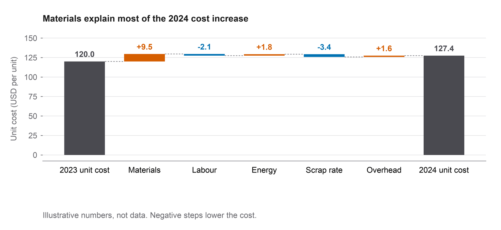
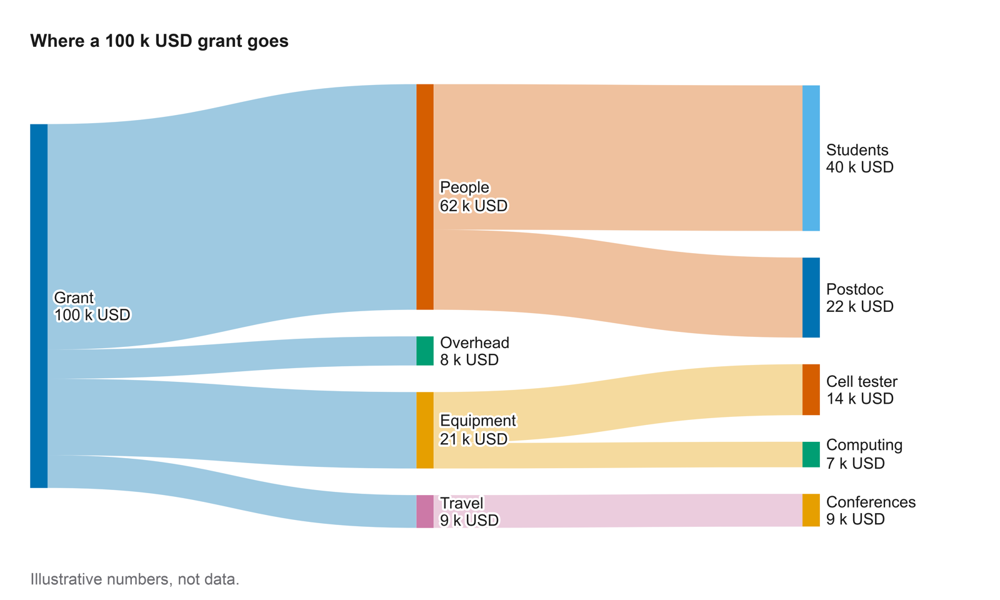
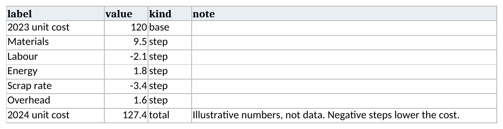
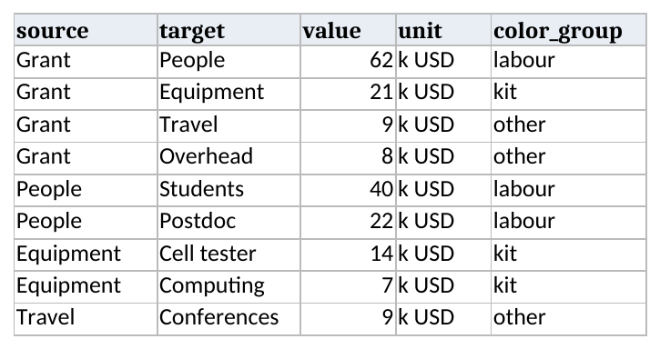
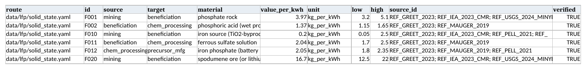
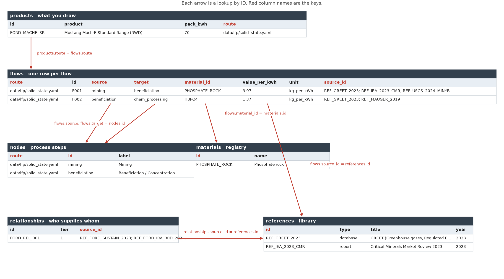
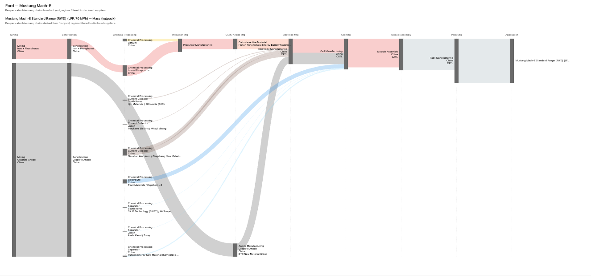

# figure-tools

figure-tools draws waterfall, Sankey and material-flow figures from a table. It
handles layout, color, type and export to PDF, SVG and PNG, plus interactive
HTML for Sankeys. The `paper` style uses hairlines, an 8 pt type floor and a
colorblind-safe palette. The `deck` style uses big type and heavy strokes for
slides.




## Quickstart

Python 3.10 or newer.

```bash
git clone https://github.com/cminehar-coder/figure-tools.git
cd figure-tools
uv venv && uv pip install -e ".[tables]"   # or: python -m venv .venv && .venv/bin/pip install -e ".[tables]"
python examples/table_examples.py           # writes examples/out/waterfall_table.* and sankey_table.*
```

The `tables` extra adds pandas and openpyxl, which you need for Excel files and
DataFrames. CSV files work without it.

## Start from a table

The charts read a table. The table can be a CSV path, an Excel path (add
`sheet=` to pick a sheet) or a pandas DataFrame, and the three give the same
figure.

### Waterfall

| label | value | kind | note |
|---|---|---|---|
| 2023 unit cost | 120 | base | |
| Materials | 9.5 | step | |
| Labour | -2.1 | step | |
| Energy | 1.8 | step | |
| Scrap rate | -3.4 | step | |
| Overhead | 1.6 | step | |
| 2024 unit cost | 127.4 | total | Illustrative numbers, not data. |



- `kind` is `base` (the first row), `step` or `total`.
- On a `total` row, `value` is the total you measured separately. The steps
  must add up to it, or the call raises an error with the difference.
- `note` is optional.

```python
from figure_tools import Waterfall

w = Waterfall.from_table("examples/tables/waterfall.csv", profile="paper",
                         title="Materials explain most of the 2024 cost increase")
w.save("out/bridge")                      # out/bridge.pdf, .svg, .png
```

### Sankey

| source | target | value | unit | color_group |
|---|---|---|---|---|
| Grant | People | 62 | k USD | labour |
| Grant | Equipment | 21 | k USD | kit |
| Grant | Travel | 9 | k USD | other |
| People | Students | 40 | k USD | labour |
| Equipment | Cell tester | 14 | k USD | kit |

The example file has 9 rows. This is the top of it.



- A node is a name that appears in `source` or `target`. There is no separate
  node list.
- Flows that share a `color_group` share a color.
- `unit` and `color_group` are optional.
- The longest path through the flows sets the columns. Cycles and flows of zero
  or less raise an error.

```python
from figure_tools import Sankey

s = Sankey.from_table("examples/tables/sankey.xlsx", title="Where a 100 k USD grant goes")
s.save("out/grant")                       # PDF, SVG, PNG
s.save_html("out/grant.html")             # interactive, hover for values
```

### Material flow

The material-flow Sankey draws a supply chain from kg of material per kWh of
cell capacity. It takes one Excel workbook with several sheets, or a folder of
CSVs with the same names. The `flows` sheet is the main one:



The other sheets are looked up from `flows` by ID:

| sheet | one row is | joins to |
|---|---|---|
| `flows` | a flow of one material between two process steps | `source` and `target` are `nodes.id`, `material_id` is `materials.id`, `source_id` is `references.id` |
| `nodes` | a process step (mining, beneficiation, ...) | |
| `materials` | a material in the registry (name, formula, category) | |
| `references` | a source (title, author, year, URL) | |
| `products` | a vehicle trim and the route it draws | `route` matches `flows.route` |
| `relationships` | a named supplier link (who supplies whom, tier) | `source_id` is `references.id` |



The `flows` columns are `route`, `id`, `source`, `target`, `material_id`,
`value_per_kwh`, `unit`, `low`, `high`, `source_id` and `verified`. `low` and
`high` are the uncertainty range. `source_id` holds one or more reference IDs
separated by `;`. The other sheets are described in
`examples/materials/schema/schema_definition.yaml`.

The call has the same shape as the other charts:

```python
from figure_tools import MaterialFlow

m = MaterialFlow.from_table("examples/materials/tables/mache.xlsx", vehicle="Mustang Mach-E")
m.save("out/mache")                       # PDF, SVG, PNG, like Sankey
m.save_html("out/mache.html")             # interactive D3 with the trims, plus a bibliography
```

`MaterialFlow` is a `Sankey`. It reads the tables, scales the flows to the pack
and splits them by country, then draws through the same code as `Sankey`, with
the same `paper` and `deck` styles and the same `save()`. `save_html()` writes a
D3 page with hover text and reference numbers, and a bibliography (`.md` and
`.csv`) next to it. The HTML loads d3 from a CDN, so it needs a network
connection.



### From YAML

The Mach-E supply chain started as YAML, and `MaterialFlow` still reads it.
Here is one flow from `examples/materials/data/lfp/solid_state.yaml`:

```yaml
- id: F001
  from: mining
  to: beneficiation
  material: phosphate rock
  material_id: PHOSPHATE_ROCK
  value: 3.97
  unit: kg_per_kWh
  uncertainty: {low: 3.2, high: 5.1, method: literature_range}
  source_ids: [REF_GREET_2023, REF_IEA_2023_CMR, REF_USGS_2024_MINYB]
```

In the table, `from` and `to` become `source` and `target`, `value` becomes
`value_per_kwh`, and the `uncertainty` block becomes `low` and `high`. The
materials registry (`schema/materials_registry.yaml`) and the reference library
(`sources/references.yaml`) become the `materials` and `references` sheets.

```python
m = MaterialFlow.from_yaml("examples/materials/data/supply_chains/ford.yaml",
                           vehicle="Mustang Mach-E")
```

Keep `schema/` and `sources/` next to the data, as in `examples/materials/`.

To move between the two formats, use the converter:

```bash
figure-tools-materialflow convert ford.yaml mache.xlsx    # YAML to one workbook (or a folder of CSVs)
figure-tools-materialflow convert mache.xlsx yaml_out/    # tables to YAML
```

`examples/materials/` ships the Mach-E data in both forms.

### Command line

The command line is a thin wrapper over `MaterialFlow`:

```bash
figure-tools-materialflow --table examples/materials/tables/mache.xlsx --vehicle "Mustang Mach-E" --out out/mache
figure-tools-materialflow --supply-chain examples/materials/data/supply_chains/ford.yaml --vehicle "Mustang Mach-E" --out out/mache
```

It writes `out/mache.pdf`, `.svg`, `.png` and `.html`, and the bibliography.

## Python API

The table route calls these methods for you. Use them when the data comes from
code and not from a file.

Waterfall:

```python
from figure_tools import Waterfall

w = Waterfall(profile="paper")            # or "deck"
w.title("Materials explain most of the 2024 cost increase")
w.baseline("2023 unit cost", 120.0)
w.step("Materials", +9.5)
w.step("Labour", -2.1)
w.total("2024 unit cost", expect=127.4)   # errors if the steps do not add up to 127.4
w.ylabel("Unit cost (USD per unit)")
w.save("out/bridge")
```

Sankey:

```python
from figure_tools import Sankey

s = Sankey(profile="paper")
s.title("Where a 100 k USD grant goes")
s.unit("k USD")
s.flow("Grant", "People", 62)
s.flow("Grant", "Equipment", 21)
s.flow("People", "Students", 40)
s.save("out/grant")
s.save_html("out/grant.html")
```

## Checks

- A missing column or a total that doesn't match the steps raises an error that
  names the column or the row.
- `total(expect=...)` raises an error if the steps don't add up to a total you
  got some other way.
- Decimals are picked so the printed labels sum to the printed total and the
  smallest step stays readable.
- matplotlib reads `$...$` as math and italicizes the text in between. A bare
  `$` in a title or label raises an error. Write `\$` instead.
- PDFs embed TrueType text (not Type 3) and SVGs keep live text, so a copy
  editor can fix a typo without redrawing. A missing glyph raises an error.

## Limits

- The example numbers are made up, except Mach-E, which uses the public sources
  in its bibliography.
- Fonts aren't bundled with the package. The styles ask for Arial, Helvetica or
  Liberation Sans and fall back to DejaVu Sans, which ships with matplotlib
  (free license).
- For dense graphs (dozens of nodes per column), use the HTML Sankey. The static
  one draws labels over the flows with a white halo.

## Tests

```bash
uv venv && uv pip install -e ".[test]" && .venv/bin/pytest
```

The tests render the examples from scratch and check the outputs. The waterfall
and Sankey examples render from CSV, Excel and a DataFrame, and the Mach-E data
renders through `MaterialFlow` from YAML, Excel and CSV.

## Cite

GitHub's "Cite this repository" button reads `CITATION.cff`. Once a release is
archived on Zenodo, cite its DOI.

## License

MIT, copyright Cooper Minehart. See `LICENSE`.
